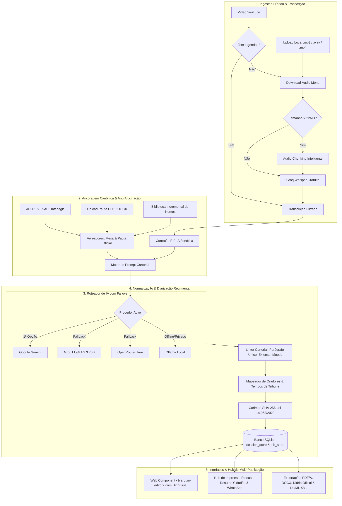

<p align="center">
  
</p>

<h1 align="center">tVerbum</h1>

<p align="center">
  <strong>Motor Cartorial Inteligente & Redator Automatizado de Atas Plenárias com IA</strong><br />
  <em>Geração de atas legislativas de padrão notarial brasileiro com paridade cartorial, integração ao SAPL Interlegis, processamento assíncrono, auditoria de diff e hub de imprensa.</em>
</p>

<p align="center">
  <a href="https://github.com/TTreter/tVerbum/releases/latest">
    
  </a>
  <a href="LICENSE">
    
  </a>
  
  
  
  
  
  
  
</p>

---

## 🏛️ Visão Geral

O **tVerbum** é uma solução completa de engenharia de software e inteligência artificial projetada para solucionar o gargalo mais custoso e burocrático dos poderes legislativos e órgãos colegiados brasileiros: a redação, conferência, aprovação e publicação de **Atas de Sessões Plenárias**.

Câmaras Municipais, Assembleias Legislativas, Conselhos Universitários e Tribunais gravam horas de transmissões em áudio e vídeo (frequentemente no YouTube ou mesas de som locais). Transformar esse material bruto em um documento com **fé pública** exige horas de digitação manual por servidores públicos e secretários legislativos, sob risco constante de erros na grafia de nomes de parlamentares, numerações de projetos de lei ou violação de regras notariais estritas (parágrafo único legal, ausência de abreviações e números por extenso).

O **tVerbum** atua como uma camada de orquestração cartorial autônoma: ingere vídeos do YouTube ou arquivos de áudio/vídeo locais, ancora os dados na pauta oficial do **SAPL / Interlegis**, transcreve em segundos via Whisper fatiado, redige a ata formal respeitando 100% da legislação brasileira, gerencia o ciclo de vida documental e entrega produtos de comunicação para a imprensa e redes sociais.

---

## 📐 Arquitetura do Sistema



---

## ⚡ Principais Funcionalidades

### 📦 1. Ingestão Híbrida & Audio Chunking Automático (<22MB Groq Whisper)
* **Entrada Dual:** Aceita link público do YouTube (canais oficiais da Câmara) ou upload direto (`POST /api/upload-media`) de gravações locais (`.mp3`, `.wav`, `.m4a`, `.aac`, `.mp4`, `.mkv`).
* **Fatiamento Inteligente (*Chunking*):** Arquivos de áudio de sessões longas (>2 horas ou >22MB) são divididos automaticamente em fatias temporais com sobreposição de 5 segundos, respeitando os limites da Groq Cloud e concatenando timestamps `[HH:MM:SS]` de forma contínua.
* **Economia Extrema de Tokens:** Prioriza legendas em texto (`0 tokens multimídia`). Em gravações sem legenda, o Whisper transcreve em velocidade ultrarrápida (250+ palavras/s).

### ⚙️ 2. Arquitetura Assíncrona de Background Jobs com SSE (Server-Sent Events)
* **Sem Timeouts HTTP 504:** Endpoint `POST /api/generate-async` enfileira a geração em segundo plano e retorna um `job_id` em milissegundos.
* **Barra de Progresso Reativa:** Endpoint SSE (`GET /api/jobs/{job_id}/stream`) transmite o progresso percentual (0% a 100%) e o status atual (*"Baixando áudio"*, *"Transcrevendo fatias"*, *"Validando normas cartoriais"*).
* **Persistência Total em SQLite:** Adeus à perda de atas por reinício de servidor. Histórico completo armazenado nas tabelas `session_store` e `job_store`.

### 🏛️ 3. Conector Oficial com o SAPL / Interlegis (API REST Pública)
* **Integração sem Autenticação:** Conecta-se às APIs públicas abertas de qualquer Câmara Municipal brasileira que utilize o SAPL do Programa Interlegis do Senado Federal.
* **Importação Nominal de Parlamentares:** Extrai nome completo, nome parlamentar (nome de urna) e partido político, injetando na Biblioteca de Nomes com 1 clique.
* **Captura de Mesa Diretora e Presenças:** Preenche automaticamente quem presidiu e secretariou a sessão, além do quórum regimental de presentes e ausentes.
* **Captura da Ordem do Dia:** Carrega tipos de matéria (*Projeto de Lei*, *Indicação*, *Moção*), números, autores, ementas e deliberações registradas no painel eletrônico.

### 📜 4. Ancoragem de Pauta Oficial & Parser Inteligente (PDF / Word Anti-Alucinação)
* **Parser Determinístico (`AgendaParser`):** Extrai proposições a partir de arquivos `.pdf`, `.docx` ou texto copiado da pauta da sessão.
* **Blindagem Contra Alucinações:** A pauta oficial é injetada no prompt como verdade jurídica canônica. O modelo atua como classificador do resultado (*Aprovado por unanimidade*, *Rejeitado*, *Pedido de vista*, *Encaminhado às comissões*), sem inventar números ou anos de leis.

### 🎙️ 5. Mapeamento Heurístico de Oradores & Diarização Regimental
* **Detecção de Concessões da Mesa:** O motor [`SpeakerMapper`](tverbum/speaker_mapper.py) identifica fórmulas regimentais consagradas da Presidência (*"Concedo a palavra ao nobre Vereador..."*, *"Com a palavra o Secretário para a leitura do expediente..."*, *"Orador inscrito..."*).
* **Cálculo de Tempos de Tribuna:** Apura o tempo de fala utilizado por cada parlamentar durante o Pequeno Expediente, Grande Expediente e Explicações Pessoais.
* **Linha do Tempo Sincronizada:** Gera a lista de marcadores `timeline_map` com timestamps clicáveis que abrem o vídeo exatamente no minuto do pronunciamento.

### ✍️ 6. Workflow Notarial & Ciclo de Vida da Ata
* **Estados Oficiais de Tramitação:** Suporte ao ciclo de vida notarial através do campo `document_status`:
  * `rascunho_ia`: Minuta bruta gerada pela inteligência artificial;
  * `em_revisao`: Documento em conferência pelo secretário legislativo;
  * `pronta_para_leitura`: Pronta para leitura e votação em plenário;
  * `aprovada_com_ressalvas`: Aprovada com retificações registradas em ata;
  * `aprovada_definitiva`: Publicada, assinada e arquivada em definitivo.
* **Persistência Imediata:** Atualização de status e texto revisado via `PUT /api/session/{minute_id}`.

### 🔍 7. Comparação de Versões com Diff Visual no `<tverbum-editor>`
* **Botão "🔍 Ver Alterações (Diff)":** Compara em tempo real a redação original produzida pela IA (`original_body`) com as edições manuais feitas pelo usuário.
* **Destaques Gráficos Instantâneos:** Renderiza trechos excluídos com fundo vermelho tachado (`<del>`) e acréscimos com fundo verde sublinhado (`<ins>`), com contador de palavras alteradas.

### 💾 8. Salvamento Automático Local Anti-Perda (localStorage)
* **Proteção Contra Fechamento Acidental:** Cada caractere digitado no `<tverbum-editor>` é sincronizado com o `localStorage` do navegador com debounce inteligente.
* **Banner de Recuperação:** Ao recarregar a página, o sistema detecta se há um rascunho mais recente não salvo no servidor e permite restaurá-lo com 1 clique.

### 🔐 9. Carimbo de Autenticidade & Hash SHA-256 (Lei Federal nº 14.063/2020)
* **Assinatura Eletrônica e Integridade Documental:** Gera hash criptográfico estável SHA-256 calculado sobre a integridade do texto consolidado (`full_text`).
* **Carimbo Notarial no Rodapé:** Tanto os arquivos gerados em PDF quanto em DOCX trazem a chave pública de autenticidade no rodapé, permitindo auditoria e verificação de conformidade jurídica.

### 📢 10. Hub de Imprensa, Comunicação & WhatsApp (Sinergia tNuntia)
* **Releases Jornalísticos (`POST /api/generate-news-release`):** Transforma o texto burocrático da ata em matéria jornalística oficial para o portal da Câmara (manchete, subtítulo, lide jornalístico e declarações).
* **Resumo Cidadão & WhatsApp (`POST /api/generate-citizen-summary`):** Síntese em linguagem descomplicada (nível popular de leitura) formatada com emojis e negritos para listas de transmissão do WhatsApp e canais municipais de aviso.
* **Dossiê Parlamentar por Vereador (`POST /api/generate-councilor-dossier`):** Recorte individualizado com tempo de tribuna, matérias propostas e legenda pronta com hashtags para redes sociais (Instagram/Facebook).

### 📑 11. Multi-Exportação Oficial (PDF/A, DOCX, Diário Oficial e LexML)
* **Word (.docx) & PDF (.pdf):** Diagramação oficial de folha timbrada, suporte a Brasão Municipal em alta resolução, cabeçalho institucional, alinhamento justificado e linhas de assinatura da Mesa Diretora.
* **Diário Oficial dos Municípios:** Formato em coluna única e bloco contínuo padronizado para diagramação gráfica em diários oficiais eletrônicos.
* **LexML Brasil (XML):** Exportação estruturada no padrão nacional de interoperabilidade legislativa do Senado Federal e Governo Federal (Lei Federal nº 14.063/2020).

### 🤖 12. Roteamento Multi-Provedor com Failover Automático & Frugalidade
* **Resiliência Total:** Alterna automaticamente entre Google Gemini, Groq Cloud, OpenRouter e Ollama Local caso ocorra lentidão, limites de requisições por minuto (`HTTP 429`) ou queda de conexão.
* **Modo Compacto para Modelos Menores:** Otimizador de prompt para modelos gratuitos com limites de TPM restritos.

### 👤 13. Biblioteca Incremental e Fonética de Nomes Próprios
* **Correção Determinística Pré e Pós-IA:** Corrige erros fonéticos típicos de transcrição de áudio (*Schneider/Esneider*, *Scherer/Xerer*, *Thiago/Tiago*), preservando a grafia oficial de parlamentares e autoridades.
* **Recurso "👤 Ensinar Nome":** Permite cadastrar uma correção com 2 cliques diretamente dentro do editor visual.

---

## 🌐 Comparativo de Provedores de IA Suportados

| Provedor | Modelo Padrão | Janela Contexto | Camada Gratuita | Destaque no tVerbum |
| :--- | :--- | :--- | :--- | :--- |
| **Google Gemini** | `gemini-3.8-flash` / `gemini-2.5-flash` | 1.000.000 tokens | 15 RPM / 1M TPM / 1.500 RPD | Janela gigante de contexto, compreensão notarial e Structured Outputs nativos. |
| **Groq Cloud** | `llama-3.3-70b-versatile` | 128.000 tokens | 30 RPM / 6.000 TPM / 14.400 RPD | **Velocidade extrema** (250+ tok/s) e Whisper gratuito para fatiamento de áudio. |
| **OpenRouter** | `google/gemini-2.0-flash-exp:free` | 128.000 tokens | ~20 RPM (conforme modelo) | Excelente backup universal com múltiplos modelos gratuitos disponíveis. |
| **Ollama Local** | `qwen2.5:7b` ou `llama3.2:3b` | Ilimitado | **Sem limites (100% offline)** | Privacidade absoluta e soberania de dados para Câmaras com rede restrita. |

---

## 🛠️ Stack Tecnológica

| Camada | Tecnologia | Descrição |
| :--- | :--- | :--- |
| **Backend Runtime** | [Python 3.10+](https://www.python.org/) | Motor assíncrono moderno e biblioteca padrão robusta |
| **Framework Web** | [FastAPI](https://fastapi.tiangolo.com/) | API REST assíncrona de alto desempenho com OpenAPI / Swagger |
| **Servidor ASGI** | [Uvicorn](https://www.uvicorn.org/) | Servidor de produção ultrarrápido baseado em `uvloop` |
| **Inteligência Artificial** | Google GenAI SDK, Groq SDK, OpenRouter, Ollama | Roteamento multi-provedor com failover transparente |
| **Transcrição & Áudio** | Groq Whisper (`whisper-large-v3-turbo`), `imageio-ffmpeg`, `pydub` | Extração, fatiamento e reconhecimento fonético |
| **Persistência Local** | SQLite nativo (`VideoCache`) | Armazenamento de sessões, jobs, fila de background e biblioteca de nomes |
| **Formatos Documentais** | `python-docx`, `reportlab`, `pypdf` | Geração com diagramação oficial de DOCX e PDF/A |
| **Web Component** | Vanilla JavaScript (Shadow DOM Custom Element) | Componente standalone `<tverbum-editor>` sem dependência de frameworks |
| **Padrões Oficiais** | LexML Brasil, Diário Oficial, Lei Federal nº 14.063/2020 | Autenticidade cartorial e conformidade legislativa nacional |

---

## 🚀 Como Instalar & Executar

### Pré-requisitos
* **Python 3.10** ou superior instalado.
* `git` instalado.
* `ffmpeg` (instalado automaticamente via pacote Python `imageio-ffmpeg`).

### 1. Clonar o repositório
```bash
git clone https://github.com/TTreter/tVerbum.git
cd tVerbum
```

### 2. Criar ambiente virtual e instalar dependências
```bash
# Criar ambiente virtual
python -m venv venv

# Ativar no Windows:
venv\Scripts\activate

# Ativar no Linux/macOS:
source venv/bin/activate

# Instalar dependências
pip install -r requirements.txt
```

### 3. Configurar variáveis de ambiente (`.env`)
Copie o modelo de ambiente:
```bash
cp .env.example .env
```
Edite o arquivo `.env` com a sua chave de API gratuita de preferência:
```env
# Provedor padrão: 'auto' | 'gemini' | 'groq' | 'openrouter' | 'ollama'
AI_PROVIDER=auto

# Chaves de API Gratuitas (configure ao menos uma):
GEMINI_API_KEY=sua_chave_gemini_aqui
GROQ_API_KEY=sua_chave_groq_aqui
OPENROUTER_API_KEY=sua_chave_openrouter_aqui

# Ollama Local (opcional para execução 100% offline):
OLLAMA_BASE_URL=http://localhost:11434
OLLAMA_MODEL=qwen2.5:7b

PORT=8000
```

### 4. Executar o servidor
No Windows, dê dois cliques em **`iniciar_tverbum.bat`** ou execute:
```bash
python run_server.py
```
* **Aplicação Web Integrada:** `http://localhost:8000`
* **Swagger UI (Documentação Interativa):** `http://localhost:8000/docs`
* **Redoc:** `http://localhost:8000/redoc`

---

## 💻 Exemplos de Consumo & Integração

### Opção 1: Consumir via API REST (Headless Facilitador - JSON)
Qualquer sistema externo (em **Next.js**, **React**, **Vue**, **PHP / Laravel**, **Django**, **Java / Spring**) pode gerar e receber atas completas:

```javascript
// Geração assíncrona recomendada com monitoramento de progresso
const jobRes = await fetch('http://localhost:8000/api/generate-async', {
  method: 'POST',
  headers: { 'Content-Type': 'application/json' },
  body: JSON.stringify({
    video_url: 'https://www.youtube.com/watch?v=dQw4w9WgXcQ',
    session_number: '40/2026',
    preset_id: 'camara_exemplo',
    single_paragraph: true,
    numbers_in_words: true,
    detail_level: 'padrao'
  })
});
const { job_id } = await jobRes.json();

// Escutar o progresso em tempo real via Server-Sent Events (SSE):
const eventSource = new EventSource(`http://localhost:8000/api/jobs/${job_id}/stream`);
eventSource.onmessage = (event) => {
  const job = JSON.parse(event.data);
  console.log(`Progresso: ${job.progress_percent}% - ${job.step_description}`);

  if (job.status === 'completed') {
    eventSource.close();
    console.log('Ata gerada com sucesso!', job.result.body);
    console.log('Chave SHA-256:', job.result.integrity_hash);
  }
};
```

---

### Opção 2: Importar o Web Component `<tverbum-editor>` no Frontend
O `<tverbum-editor>` é um componente web puro (*Custom Element*) encapsulado em Shadow DOM. Pode ser adicionado a qualquer página web sem conflito de CSS:

```html
<!-- 1. Carrega o script standalone do tVerbum -->
<script src="http://localhost:8000/tverbum-editor.js"></script>

<!-- 2. Adiciona o componente na página -->
<tverbum-editor id="meu-editor" api-base="http://localhost:8000" show-save-button></tverbum-editor>

<script>
  const editor = document.getElementById('meu-editor');

  // Carrega a ata retornada pela API
  editor.setMinute(jobResult);

  // Escuta quando o revisor clica no botão "Salvar Ata"
  editor.addEventListener('tverbum-save', (event) => {
    const ataRevisada = event.detail;
    console.log('Texto com as alterações humanas:', ataRevisada.body);
    console.log('Status notarial:', ataRevisada.document_status);
    salvarNoBancoDeDados(ataRevisada);
  });

  // Escuta alterações de status no fluxo cartorial
  editor.addEventListener('tverbum-status-change', (event) => {
    console.log('Novo status documental:', event.detail.status);
  });
</script>
```

---

## 📡 Endpoints da API REST

| Categoria | Método | Rota | Descrição |
| :--- | :---: | :--- | :--- |
| **Geração & Jobs** | `POST` | `/api/generate` | Gera a ata síncrona com failover automático e cache SQLite |
| | `POST` | `/api/generate-async` | Inicia processamento assíncrono em segundo plano (Jobs Queue) |
| | `GET` | `/api/jobs/{job_id}` | Consulta status e resultado de um job assíncrono |
| | `GET` | `/api/jobs/{job_id}/stream` | Stream em tempo real com barra de progresso via Server-Sent Events (SSE) |
| **Mídia & Upload** | `POST` | `/api/upload-media` | Upload de arquivos de áudio/vídeo locais (`.mp3`, `.wav`, `.mp4`) |
| | `GET` | `/api/transcription/{video_id}` | Recupera a transcrição e timestamps salvos no cache SQLite |
| **Sessões & Workflow** | `GET` | `/api/session/{minute_id}` | Consulta ata persistida por UUID ou `'latest'` |
| | `PUT` | `/api/session/{minute_id}` | Atualiza texto, status notarial e recalcula hash SHA-256 |
| **Conector SAPL** | `POST` | `/api/sapl/test` | Testa conectividade com a API REST de uma Câmara Municipal |
| | `POST` | `/api/sapl/sync-names` | Sincroniza parlamentares do SAPL para a Biblioteca de Nomes |
| | `POST` | `/api/sapl/fetch-session` | Importa sessão, Mesa Diretora, presenças e Ordem do Dia do SAPL |
| **Pauta Oficial** | `POST` | `/api/agenda/extract` | Extrai proposições a partir de texto colado da pauta |
| | `POST` | `/api/agenda/upload` | Extrai proposições a partir de arquivo PDF ou Word (.docx) da pauta |
| **Oradores** | `POST` | `/api/speakers/detect` | Mapeia anúncios regimentais da Mesa e apura tempos de tribuna |
| **Hub de Imprensa** | `POST` | `/api/generate-news-release` | Gera release jornalístico estruturado com manchete e lide |
| | `POST` | `/api/generate-citizen-summary` | Gera resumo cidadão e texto formatado para transmissão no WhatsApp |
| | `POST` | `/api/generate-councilor-dossier` | Gera dossiê parlamentar de atuação e post pronto para redes sociais |
| **Exportação** | `POST` | `/api/export` | Exporta a ata para `.pdf`, `.docx`, `.txt`, `.md`, `.xml` (LexML) ou `.txt` (Diário Oficial) |
| | `POST` | `/api/export/lexml` | Devolve XML oficial no padrão LexML Brasil |
| | `POST` | `/api/export/official-gazette`| Devolve texto diagramado para Diário Oficial dos Municípios |
| **Edição & Nomes** | `POST` | `/api/validate-text` | Aplica o linter cartorial (extenso, abreviações, parágrafo único) |
| | `POST` | `/api/refine-snippet` | Reescreve ou melhora trecho selecionado com IA |
| | `GET` | `/api/names` | Lista registros da Biblioteca Incremental de Nomes |
| | `POST` | `/api/names` | Cadastra nome oficial e apelidos fonéticos |
| | `POST` | `/api/names/quick-learn` | Ensina rapidamente uma grafia errada identificada na ata |
| **Infraestrutura** | `GET` | `/api/providers` | Lista provedores de IA ativos e testes de latência (`?test=true`) |
| | `DELETE`| `/api/cache` | Limpa o cache SQLite de vídeos, atas e jobs |
| | `GET` | `/tverbum-editor.js` | Entrega o Web Component `<tverbum-editor>` standalone |

---

## 🔒 Integridade Cartorial, Privacidade & Segurança

* **Conformidade Notarial (Lei Federal nº 14.063/2020):** Toda ata consolidada tem seu hash criptográfico SHA-256 gerado automaticamente e impresso nos rodapés dos arquivos PDF e Word.
* **Redução a Zero de Alucinações:** O uso combinado da pauta oficial do SAPL e do parser de PDF/DOCX atua como âncora factual obrigatória.
* **Modo 100% Offline e Privado:** Câmaras Municipais que não possam trafegar dados na nuvem pública podem operar o tVerbum exclusivamente com **Ollama Local (`qwen2.5` ou `llama3.2`)**, sem envio de dados a servidores externos.
* **Sanitização contra Injeções de Prompt:** Todos os dados de entrada (título do vídeo, nomes e transcrições) passam por sanitização determinística antes de serem avaliados pelo motor de IA.

---

## 📄 Licença

Distribuído sob a licença **MIT**. Consulte o arquivo [LICENSE](LICENSE) para mais detalhes.

---

<p align="center">
  Desenvolvido por <strong>Tiago Treter</strong>
</p>
