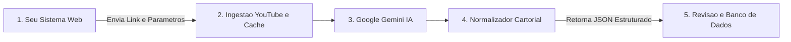

# 🏛️ tVerbum


> **Motor facilitador para redação, validação cartorial e revisão assistida de atas de sessões plenárias e reuniões a partir de vídeos do YouTube.**

O **tVerbum** foi projetado para se integrar facilmente aos seus sistemas web (em **Python**, **JavaScript/Node.js**, **Next.js**, **PHP/Laravel**, etc.). Basta fornecer o **link do vídeo no YouTube** e o **número da ata** para receber um **JSON estruturado** contendo o texto formal da ata (em parágrafo único contínuo, com datas/horários por extenso e sem abreviações), além dos dados prontos para o seu banco de dados (presentes, ausentes, matérias votadas e linha do tempo do vídeo).

---

## ✨ Principais Recursos

- **Motor Facilitador JSON (`Headless First`)**:
  - Devolve em uma única requisição o texto formal do corpo da ata (`body`) e o objeto `extracted_data` (data ISO `YYYY-MM-DD`, horários de abertura e encerramento, lista de presentes e matérias votadas).
- **Web Component Importável (`<tverbum-editor>`)**:
  - Editor visual em formato de folha A4 oficial encapsulado em *Shadow DOM* (`/tverbum-editor.js`), que você pode importar em qualquer página do seu sistema com 1 linha de código para revisar o texto antes de salvar no seu banco de dados.
- **Regras Estritas de Redação Legislativa e Cartorial**:
  - **Parágrafo Único Contínuo (`single_paragraph`)** ou número customizável de parágrafos (`paragraph_count`).
  - **Números, Datas e Horários por Extenso (`numbers_in_words`)**: Converte horários (*"dezoito horas e sete minutos"*) e datas por extenso, preservando números oficiais de Leis, Projetos e Ofícios (*"Projeto de Lei nº 48/2026"*).
  - **Vedação a Abreviações (`allow_abbreviations=False`)**: Expande automaticamente *"Ver."* para *"Vereador"*, *"PL"* para *"Projeto de Lei"*, *"Art."* para *"Artigo"*, etc.
- **Ingestão Multimodal Inteligente + Cache SQLite**:
  - **`youtube_direct`**: Envia o vídeo do YouTube diretamente para a API multimodal do Gemini assistir e ouvir a sessão (estilo *NotebookLM*).
  - **`auto` / `captions` / `audio`**: Extrai metadados automáticos do YouTube (título, data de publicação, descrição), legendas ou stream de áudio leve via `yt-dlp`, com cache local em SQLite para reprocessamento instantâneo.
- **Ferramentas de Revisão Assistida**:
  - **Alertas de Revisão (`review_warnings`)**: Destaca em amarelo termos ou nomes que merecem conferência visual rápida.
  - **Linha do Tempo Sincronizada (`timeline_map`)**: Timestamps clicáveis que abrem o vídeo do YouTube no segundo exato de cada fala.
  - **Validador Pós-Edição (`POST /api/validate-text`)**: Garante que edições manuais feitas pelo usuário mantenham o padrão de números por extenso e parágrafo único.
  - **Reescrita Rápida de Trecho (`POST /api/refine-snippet`)**: Reescreve apenas uma frase selecionada no editor com IA em ~1 segundo.
- **Exportação Oficial com Brasão**:
  - Gera arquivos **PDF (`.pdf`)**, **Word (`.docx`)**, **Markdown (`.md`)** e **Texto (`.txt`)** diagramados com cabeçalho institucional, logotipo/brasão e linhas de assinatura.

---

## 📐 Arquitetura de Integração



---

## 🚀 Instalação e Configuração

### 1. Instalar dependências
```bash
pip install -r requirements.txt
```

### 2. Configurar a variável de ambiente (`.env`)
Copie o arquivo `.env.example` para `.env` e informe sua chave da API do Google Gemini:
```bash
cp .env.example .env
```
```env
GEMINI_API_KEY=sua_chave_aqui
DEFAULT_MODEL=gemini-3.8-flash
PORT=8000
```

### 3. Iniciar o servidor local
No Windows, basta dar dois cliques em **`iniciar_tverbum.bat`** ou executar no terminal:
```bash
python run_server.py
```
- **Interface Web de Testes**: `http://localhost:8000`
- **Documentação Interativa (Swagger)**: `http://localhost:8000/docs`

---

## 💻 Como Utilizar no Seu Sistema Web

### Opção 1: Consumir apenas o JSON (Headless Facilitador)
Ideal quando você já possui a tela de cadastro/edição de atas no seu próprio sistema:

```javascript
const response = await fetch('http://localhost:8000/api/generate', {
  method: 'POST',
  headers: { 'Content-Type': 'application/json' },
  body: JSON.stringify({
    video_url: 'https://www.youtube.com/watch?v=...',
    session_number: '21/2026',
    preset_id: 'camara_exemplo',     // Carrega cabeçalho, vereadores e partidos
    single_paragraph: true,          // Parágrafo único contínuo
    numbers_in_words: true,          // Datas e horários por extenso
    allow_abbreviations: false,      // Sem abreviações (Vereador, Projeto de Lei...)
    detail_level: 'padrao'           // 'resumido', 'padrao' ou 'detalhado'
  })
});

const ata = await response.json();

// 1. Texto corrido da ata pronto para exibir no seu sistema:
console.log(ata.body);

// 2. Dados estruturados prontos para salvar nas colunas do seu banco de dados:
console.log(ata.extracted_data.session_date_iso); // "2026-09-28"
console.log(ata.extracted_data.start_time);       // "18:07"
console.log(ata.extracted_data.present_members);  // ["Carlos Eduardo da Silva", ...]
console.log(ata.extracted_data.voted_matters);    // [{ matter: "Projeto de Lei nº 48/2026", result: "Aprovado por unanimidade" }]
```

---

### Opção 2: Importar o Componente `<tverbum-editor>` no seu Frontend
Se quiser embutir a folha timbrada editável (com botão de normalização cartorial, reescrita de trecho com IA e destaque de revisão) dentro do seu sistema:

```html
<!-- 1. Importe o Web Component diretamente do servidor tVerbum -->
<script src="http://localhost:8000/tverbum-editor.js"></script>

<!-- 2. Adicione a tag onde desejar na sua página -->
<tverbum-editor id="meu-editor" api-base="http://localhost:8000" show-save-button></tverbum-editor>

<script>
  const editor = document.getElementById('meu-editor');

  // Carrega o JSON retornado pelo POST /api/generate
  editor.setMinute(ata);

  // Escuta o clique no botão "Salvar Ata" para gravar no banco de dados do seu sistema:
  editor.addEventListener('tverbum-save', (event) => {
    const ataRevisada = event.detail;
    console.log('Texto revisado:', ataRevisada.body);
    // Envie ataRevisada para o backend do seu sistema!
  });
</script>
```

---

### Opção 3: Uso Direto como Biblioteca Python
```python
from tverbum import MinuteConfig, generate_minute, MinuteExporter

config = MinuteConfig(
    video_url="https://www.youtube.com/watch?v=...",
    session_number="21/2026",
    preset_id="camara_exemplo",
    single_paragraph=True,
    numbers_in_words=True,
    allow_abbreviations=False,
)

minute = generate_minute(config)
print(minute.body)

# Opcional: exportar para PDF ou Word (.docx)
MinuteExporter.to_pdf(minute, "Ata_21_2026.pdf")
MinuteExporter.to_docx(minute, "Ata_21_2026.docx")
```

---

## ⚙️ Parâmetros de Configuração (`MinuteConfig`)

| Parâmetro | Tipo | Padrão | Descrição |
| :--- | :--- | :--- | :--- |
| `video_url` | `str` | *(obrigatório)* | Link do vídeo da sessão no YouTube |
| `session_number` | `str` | *(obrigatório)* | Número da ata (ex: `"21/2026"`) |
| `preset_id` | `str \| None` | `None` | ID de um perfil institucional salvo (ex: `"camara_exemplo"`) |
| `session_type` | `str` | `"Sessão Ordinária"` | Tipo da sessão plenária ou reunião |
| `organization_name` | `str` | `""` | Nome da Câmara, Conselho ou Instituição |
| `state` | `str` | `""` | Estado da federação |
| `single_paragraph` | `bool` | `True` | Se `True`, redige em parágrafo único contínuo |
| `paragraph_count` | `int` | `1` | Quantidade exata de parágrafos desejada (`1` a `30`) |
| `numbers_in_words` | `bool` | `True` | Se `True`, escreve datas, horas e números por extenso |
| `allow_abbreviations` | `bool` | `False` | Se `False`, expande abreviações (`Ver.` → `Vereador`, `PL` → `Projeto de Lei`) |
| `detail_level` | `str` | `"padrao"` | Profundidade dos discursos: `"resumido"`, `"padrao"` ou `"detalhado"` |
| `ingestion_mode` | `str` | `"auto"` | `"auto"`, `"youtube_direct"`, `"captions"` ou `"audio"` |
| `known_attendees` | `list[str]` | `[]` | Lista nominal de presentes e partidos para ancorar a grafia |
| `agenda_context` | `str \| None` | `None` | Pauta / Ordem do Dia / Ofícios para ancorar números de projetos |

---

## 🔌 Endpoints da API REST

| Método | Rota | Descrição |
| :--- | :--- | :--- |
| `POST` | `/api/generate` | Gera a ata a partir do vídeo e retorna o JSON completo (`MinuteOutput`) |
| `POST` | `/api/validate-text` | Normaliza um texto editado manualmente (extenso, abreviações, parágrafo único) |
| `POST` | `/api/refine-snippet` | Reescreve apenas um trecho selecionado com IA |
| `POST` | `/api/export` | Exporta o JSON da ata (com edições do usuário) para `.pdf`, `.docx`, `.txt` ou `.md` |
| `GET` | `/api/presets` | Lista os perfis institucionais cadastrados |
| `POST` | `/api/presets` | Cria ou atualiza um perfil institucional |
| `GET` | `/tverbum-editor.js` | Entrega o Web Component `<tverbum-editor>` standalone |

---

## 📄 Licença

Distribuído sob a licença [MIT](./LICENSE).
