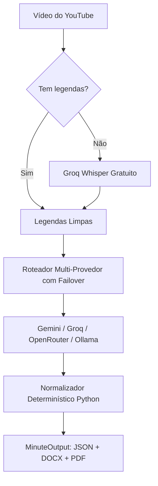

# 🏛️ tVerbum


> **Motor facilitador para redação, validação cartorial e revisão assistida de atas de sessões plenárias e reuniões a partir de vídeos do YouTube.**  
> *Projetado com arquitetura multi-provedor resiliente e otimizada para modelos de IA 100% gratuitos (Google AI Studio, Groq Cloud, OpenRouter e Ollama Local).*

O **tVerbum** foi projetado para se integrar facilmente aos seus sistemas web (em **Python**, **JavaScript/Node.js**, **Next.js**, **PHP/Laravel**, etc.). Basta fornecer o **link do vídeo no YouTube** e o **número da ata** para receber um **JSON estruturado** contendo o texto formal da ata (em parágrafo único contínuo, com datas/horários por extenso, valores monetários e sem abreviações), além dos dados prontos para o seu banco de dados (presentes, ausentes, matérias votadas e linha do tempo do vídeo).

---

## ✨ Principais Recursos

- **Arquitetura Multi-Provedor com Failover Automático**:
  - Suporte nativo a **Google Gemini**, **Groq (LLaMA 3.3 70B)**, **OpenRouter (modelos `:free`)** e **Ollama Local (100% offline e privado)**.
  - Se um provedor gratuito atingir o limite de requisições por minuto (`HTTP 429`), o sistema faz **fallback transparente** para o próximo provedor gratuito sem interromper o usuário.
- **Ingestão Frugal de Áudio e Texto (Zero Estouro de Cota)**:
  - Prioriza legendas em texto (`0 tokens multimídia`).
  - Quando o vídeo não tem legendas no YouTube, extrai automaticamente a faixa de áudio leve e utiliza o **Groq Whisper (`whisper-large-v3-turbo`) gratuito**, transcrevendo a sessão em segundos com timestamps `[HH:MM:SS]`.
  - Evita o consumo excessivo de tokens de vídeo bruto (~1.850.000 tokens em 2h), mantendo o consumo em ~25k tokens.
- **Normalizador e Linter Cartorial Determinístico**:
  - **Parágrafo Único Contínuo (`single_paragraph`)** ou divisão exata em parágrafos temáticos (`paragraph_count`).
  - **Números, Horários e Datas por Extenso (`numbers_in_words`)**: Conversão precisa de horários (*"dezoito horas e sete minutos"*), datas (*"vinte e oito de setembro de dois mil e vinte e seis"*) e ordinais (*"10ª Legislatura"* → *"décima Legislatura"*), preservando numerações de leis (*"Projeto de Lei nº 48/2026"*).
  - **Conversão Financeira e Percentual**: Transforma valores (*"R$ 150.000,00"* → *"cento e cinquenta mil reais"*) e percentuais (*"10%"* → *"dez por cento"*).
  - **Biblioteca Incremental e Fonética de Nomes (`NameLibraryManager`)**: Corrige automaticamente erros de grafia de nomes próprios causados pelo reconhecimento de voz (ex: *Thiago/Tiago*, *Luís/Luiz*, *Schneider/Esneider*, *Scherer/Xerer*), atuando antes da IA (na transcrição e no Whisper) e depois da IA (no corpo da ata, lista de presença e linha do tempo), com botão **"👤 Ensinar Nome"** direto no editor.
  - **Sanitização de Markdown**: Remove asteriscos, hashtags ou marcadores de listas que modelos menores de IA possam gerar, garantindo formato notarial limpo.
  - **Vedação a Abreviações (`allow_abbreviations=False`)**: Expande automaticamente *"Ver."* → *"Vereador"*, *"PL"* → *"Projeto de Lei"*, *"Art."* → *"Artigo"*.
- **Controle de Taxa (Rate Limiting) e Cache SQLite Estendido**:
  - Janela deslizante de requisições por minuto e retentativas com **exponential backoff e jitter**.
  - Cache SQLite de transcrições e atas completas por hash SHA-256 de configuração: reprocessamentos com os mesmos parâmetros são devolvidos instantaneamente sem gastar chamadas de IA.
- **Web Component Importável (`<tverbum-editor>`)**:
  - Editor visual em formato de folha A4 timbrada encapsulado em *Shadow DOM* (`/tverbum-editor.js`), importável em qualquer aplicação web com 1 linha de código.
- **Revisão Assistida e Exportação**:
  - **Alertas de Revisão (`review_warnings`)**: Destaca nomes e números críticos que merecem conferência humana.
  - **Linha do Tempo Sincronizada (`timeline_map`)**: Timestamps clicáveis que abrem o vídeo do YouTube no momento exato de cada fala.
  - **Reescrita Rápida de Trecho (`POST /api/refine-snippet`)**: Refina frases individuais com IA em ~1 segundo.
  - **Exportação Multiformato**: Gera **PDF (`.pdf`)**, **Word (`.docx`)**, **Markdown (`.md`)** e **Texto (`.txt`)** diagramados com brasão oficial e linhas de assinatura.

---

## 🌐 Comparativo de Provedores de IA Suportados

| Provedor | Modelo Padrão | Janela Contexto | Camada Gratuita | Destaque no tVerbum |
| :--- | :--- | :--- | :--- | :--- |
| **Google Gemini** | `gemini-3.8-flash` / `gemini-2.5-flash` | 1.000.000 tokens | 15 RPM / 1M TPM / 1.500 RPD | Enorme janela de contexto e compreensão cartorial avançada. |
| **Groq Cloud** | `llama-3.3-70b-versatile` | 128.000 tokens | 30 RPM / 6.000 TPM / 14.400 RPD | **Velocidade extrema** (250+ tokens/s) e **Whisper gratuito** para áudio. |
| **OpenRouter** | `google/gemini-2.0-flash-exp:free` | 128.000 tokens | ~20 RPM (conforme modelo) | Excelente backup universal com múltiplos modelos `:free`. |
| **Ollama Local** | `qwen2.5:7b` ou `llama3.2:3b` | Ilimitado | **Sem limites (100% offline)** | Privacidade total e autonomia para câmaras sem internet rápida. |

---

## 📐 Arquitetura do Sistema



---

## 🚀 Instalação e Execução

### 1. Clonar repositório e instalar dependências
```bash
git clone https://github.com/TTreter/tVerbum.git
cd tVerbum
pip install -r requirements.txt
```

### 2. Configurar o arquivo de ambiente (`.env`)
Copie o modelo de ambiente:
```bash
cp .env.example .env
```
Edite o arquivo `.env` com a sua chave gratuita preferida:
```env
# Provedor prioritário: 'auto' | 'gemini' | 'groq' | 'openrouter' | 'ollama'
AI_PROVIDER=auto

# Chaves gratuitas (preencha ao menos uma):
GEMINI_API_KEY=sua_chave_gemini
GROQ_API_KEY=sua_chave_groq
OPENROUTER_API_KEY=sua_chave_openrouter

# Ollama Local (opcional, sem chave):
OLLAMA_BASE_URL=http://localhost:11434
OLLAMA_MODEL=qwen2.5:7b

PORT=8000
```

### 3. Iniciar o servidor
No Windows, dê dois cliques em **`iniciar_tverbum.bat`** ou execute:
```bash
python run_server.py
```
- **Interface Web de Testes & Diagnóstico**: `http://localhost:8000`
- **Documentação Swagger Interativa**: `http://localhost:8000/docs`

---

## 💻 Exemplos de Uso

### Opção 1: Consumir apenas o JSON (Headless Facilitador)
```javascript
const response = await fetch('http://localhost:8000/api/generate', {
  method: 'POST',
  headers: { 'Content-Type': 'application/json' },
  body: JSON.stringify({
    video_url: 'https://www.youtube.com/watch?v=...',
    session_number: '21/2026',
    preset_id: 'camara_exemplo',     // Perfil salvo da Câmara
    ai_provider: 'auto',             // 'auto', 'gemini', 'groq', 'openrouter', 'ollama'
    single_paragraph: true,          // Parágrafo único contínuo notarial
    numbers_in_words: true,          // Datas, horas e moedas por extenso
    allow_abbreviations: false,      // Sem abreviações (Vereador, Projeto de Lei...)
    detail_level: 'padrao'           // 'resumido', 'padrao' ou 'detalhado'
  })
});

const ata = await response.json();

// Texto formal da ata pronto para revisão:
console.log(ata.body);

// Dados prontos para o banco de dados:
console.log(ata.extracted_data.session_date_iso); // "2026-09-28"
console.log(ata.extracted_data.present_members);  // ["Carlos Eduardo da Silva", ...]
console.log(ata.extracted_data.voted_matters);    // [{ matter: "Projeto de Lei nº 48/2026", result: "Aprovado" }]
```

---

### Opção 2: Importar o Componente `<tverbum-editor>` no seu Frontend
```html
<!-- 1. Importa o Web Component -->
<script src="http://localhost:8000/tverbum-editor.js"></script>

<!-- 2. Adiciona a folha timbrada oficial editável -->
<tverbum-editor id="meu-editor" api-base="http://localhost:8000" show-save-button></tverbum-editor>

<script>
  const editor = document.getElementById('meu-editor');
  editor.setMinute(ata); // Carrega a ata gerada pelo tVerbum

  // Escuta o salvamento após a revisão humana:
  editor.addEventListener('tverbum-save', (event) => {
    const ataRevisada = event.detail;
    salvarNoMeuBackend(ataRevisada);
  });
</script>
```

---

## 🔌 Endpoints da API REST

| Método | Rota | Descrição |
| :--- | :--- | :--- |
| `POST` | `/api/generate` | Gera a ata a partir do vídeo com failover e rate limiting (`MinuteOutput`) |
| `GET` | `/api/providers` | Lista provedores disponíveis e executa teste de latência (`?test=true`) |
| `GET` | `/api/session/{minute_id}` | Recupera uma ata gerada em memória (aceita `latest` para a mais recente) |
| `GET` | `/api/transcription/{video_id}` | Obtém a transcrição cronológica diretamente do cache ou YouTube/Whisper |
| `POST` | `/api/validate-text` | Normaliza texto editado (extenso, abreviações, moedas, parágrafo único) |
| `POST` | `/api/refine-snippet` | Reescreve frase selecionada com IA via provedor ativo |
| `POST` | `/api/export` | Exporta a ata para `.pdf`, `.docx`, `.txt` ou `.md` |
| `GET` | `/api/presets` | Lista perfis institucionais cadastrados |
| `POST` | `/api/presets` | Cadastra ou atualiza perfil institucional |
| `GET` | `/api/names` | Lista nomes oficiais e variações da Biblioteca Incremental de Nomes |
| `POST` | `/api/names` | Adiciona ou atualiza um nome oficial e seus apelidos fonéticos |
| `POST` | `/api/names/quick-learn` | Ensina rapidamente um nome (`wrong_text` → `correct_name`) |
| `DELETE`| `/api/names/{entry_id}` | Remove um registro da Biblioteca de Nomes |
| `GET` | `/tverbum-editor.js` | Entrega o Web Component `<tverbum-editor>` standalone |
| `DELETE`| `/api/cache` | Limpa o cache SQLite local |

---

## 📄 Licença

Distribuído sob a licença [MIT](./LICENSE).
